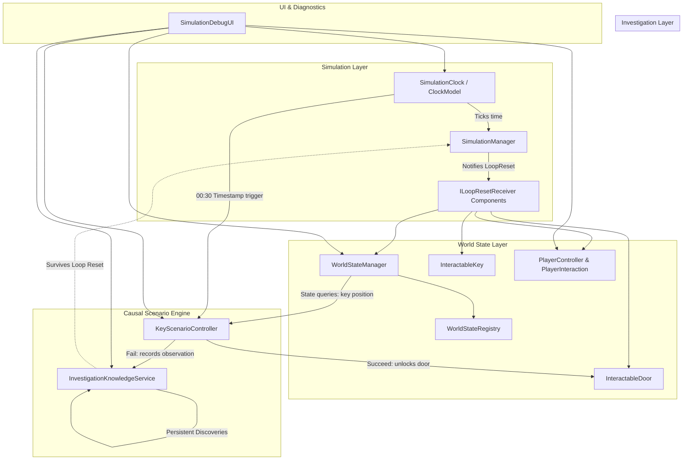

# Architecture Specification — Tomorrow's Crime

## 1. Architectural Philosophy

*Tomorrow's Crime* is built around the principle of a **deterministic causal simulation**.
Unlike conventional adventure games with branching dialog trees and linear flag triggers, this game models a small, coherent ecosystem where events occur naturally unless intervened upon by the player.

### Core Tenets
1. **Separation of Concerns:** Pure simulation and world-state rules are decoupled from Unity presentation (`MonoBehaviour` / rendering).
2. **Determinism:** Given the same initial conditions and zero player intervention, a loop produces the identical sequence of events every time.
3. **Explicit State Boundaries:** Mutable world state (doors, lights, NPC locations, keys) resets completely every 5 minutes. Persistent player knowledge (clues, observations, deduction notes) survives resets permanently.
4. **Testability:** Core logic is written in plain C# with minimal external dependencies, allowing comprehensive EditMode unit testing.

---

## 2. Core System Decomposition

---

## 3. Major Subsystems

### 3.1 Simulation Clock (`TomorrowsCrime.Simulation`)
- **Duration:** Exactly 300 seconds (5 minutes: 12:00 AM to 12:05 AM).
- **Time Scaling:** Debug multipliers (1x, 2x, 5x, 10x) for rapid playtesting.
- **Clock Model (`SimulationClockModel`):** Pure C# model containing elapsed time, loop count, time scale, pause state, and tick calculation.
- **Simulation Manager (`SimulationManager`):** MonoBehaviour bridge that updates the clock model every frame, triggers `OnTick`, and fires `OnLoopCompleted`.

### 3.2 Deterministic World State (`TomorrowsCrime.World`)
- **Registry (`WorldStateRegistry`):** Decoupled, pure C# typed dictionary tracking loop-scoped state under stable string keys (`key_room_102`, `door_room_102`).
  - Guards against duplicate ID registrations (`InvalidOperationException`).
  - Stores captured baseline states alongside mutable runtime states.
  - `ResetAllToBaseline()` restores every registered entity to its 12:00:00 condition.
- **Manager (`WorldStateManager`):** Scene-level MonoBehaviour singleton implementing `ILoopResetReceiver`. Dispatches reset signals to the registry.

### 3.3 First-Person Interaction System (`TomorrowsCrime.Player`)
- **Interface (`IInteractable`):** Defines `InteractionPrompt`, `CanInteract`, and `Interact(GameObject interactor)`.
- **Interaction Handler (`PlayerInteraction`):** Casts a 2.5m raycast forward from the player camera every frame. Detects `IInteractable` objects, debounces input (`KeyCode.E`), and feeds the contextual prompt to the HUD.

### 3.4 Causal Scenario Engine (`TomorrowsCrime.Events`)
- **Controller (`KeyScenarioController`):** Evaluates scheduled events against real world state.
- **Precondition Evaluation:** At 00:30, checks if `key_room_102` is `PropLocationState.AtBaseline`.
  - **Success:** Concierge takes key, opens Door 102.
  - **Failure:** Key was moved or taken by player. Action fails with explicit report: `"Event failed: required key was not available at the expected location."`
  - **Observation:** If witnessed, adds discovery to `InvestigationKnowledgeService`.

### 3.5 Persistent Knowledge Service (`TomorrowsCrime.Investigation`)
- **Service (`InvestigationKnowledgeService`):** Singleton knowledge store that survives loop resets.
- Deduplicates discoveries based on stable identifier (`key_missing_at_table`).
- Retains loop number and timestamp when discovery occurred.

### 3.6 Diagnostics & Observability (`TomorrowsCrime.Debugging`)
- Real-time HUD showing:
  - Loop index, elapsed & remaining time.
  - Keycard location (`At Table`, `Held by Player`, `Dropped Elsewhere`).
  - Door status (`Locked`, `Unlocked`).
  - Concierge scenario state and pass/fail reason.
  - Persistent discoveries list.
  - Center reticle and contextual interaction prompt.
