# Architecture Specification — Tomorrow's Crime

## 1. Architectural Philosophy

*Tomorrow's Crime* is built around the principle of a **deterministic causal simulation**.
Unlike conventional adventure games with branching dialog trees and linear flag triggers, this game models a small, coherent ecosystem where events occur naturally unless intervened upon by the player.

### Core Tenets
1. **Separation of Concerns:** Pure simulation and world-state rules are decoupled from Unity presentation (`MonoBehaviour` / rendering).
2. **Determinism:** Given the same initial conditions and zero player intervention, a loop produces the identical sequence of events every time.
3. **Explicit State Boundaries:** Mutable world state (doors, lights, NPC locations, keys) resets completely every 5 minutes. Persistent player knowledge (clues, observations, deduction notes) survives resets permanently.
4. **Testability:** Core logic is written in plain C# with minimal external dependencies, allowing comprehensive EditMode unit testing.

---

## 2. Core System Decomposition

```mermaid
flowchart TD
    subgraph Simulation Layer
        Clock[SimulationClock / ClockModel] -->|Ticks time| LoopMgr[SimulationManager]
        LoopMgr -->|Notifies LoopReset| Resettables[ILoopResetReceiver Components]
    end

    subgraph World State Layer
        WorldMgr[WorldStateManager] --> WorldReg[WorldStateRegistry]
        Resettables --> WorldMgr
        Resettables --> Key[InteractableKey]
        Resettables --> Door[InteractableDoor]
        Resettables --> Player[PlayerController & PlayerInteraction]
    end

    subgraph Causal Event Engine
        Scheduler[CausalEventScheduler] -->|Ticks & Resets| Engine[CausalEventEngine]
        Clock -->|SimTime feed| Scheduler
        Def[EventDefinition ScriptableObjects] -->|Registered into| Engine
        Engine -->|Evaluates| Precond[IEventPrecondition]
        Engine -->|Applies effects| Effects[IEventEffect]
        Precond -->|Reads mutable state| WorldReg
        Effects -->|Modifies mutable state| WorldReg
        Effects -.->|Door state mutations| Door
    end

    subgraph Suspect Simulation & AI Navigation
        NPC[NPCController] -->|Navigates| NavAgent[NavMeshAgent & NavMeshSurface]
        NPCDef[NPCDefinition] -->|Provides static data| NPC
        NPCSched[NPCScheduleEvaluator] -->|Evaluates simTime| NPC
        Percept[NPCPerception] -->|Sensory Cone & Line of Sight| NPC
        Clock -->|Ticks simTime| NPC
        NPC -->|Queries & updates state| WorldReg
        Resettables --> NPC
    end

    subgraph Investigation Layer
        Scenario[KeyScenarioController] -->|Observes event status| Engine
        Scenario -->|Records witnessed failure| Knowledge[InvestigationKnowledgeService]
        Knowledge -->|Persistent Discoveries| Knowledge
        Knowledge -.->|Survives Loop Reset| LoopMgr
        Knowledge --> Relationships[Evidence Relationships]
        Knowledge --> DeductionNodes[Deduction Board Nodes]
        Knowledge --> Observations[Player Observations & Cross-Loop Comparison]
    end

    subgraph User Interface Architecture
        UIMgr[UIManager] -->|Arbitrates UI State| UIStates[UIState Enum]
        UIMgr -->|Blocks/Restores Input| Player
        UIMgr -->|Controls Simulation Pause| LoopMgr
        UIMgr --> HUDView[GameHUDView]
        UIMgr --> ModalView[EvidenceInspectionModalView]
        UIMgr --> WorkspaceView[InvestigationWorkspaceView]
        UIMgr --> PauseView[PauseMenuView]
        UIMgr --> SettingsView[SettingsMenuView]
        HUDView -->|Reads Clock & Urgency| Clock
        HUDView -->|Reads Prompts| Player
        ModalView -->|Displays Clue Details| Knowledge
        WorkspaceView -->|Displays Clues, Timeline & Deduction Board| Knowledge
        SettingsView --> SettingsMgr[GameSettingsManager]
        SettingsMgr -->|Applies Sensitivity| Player
    end

    subgraph Diagnostics
        DebugHUD[SimulationDebugUI - F1] --> Clock
        DebugHUD --> WorldMgr
        DebugHUD --> Engine
        DebugHUD --> NPC
        DebugHUD --> Knowledge
        DebugHUD --> Player
    end
```

---

## 3. Major Subsystems

### 3.1 Simulation Clock (`TomorrowsCrime.Simulation`)
- **Duration:** Exactly 300 seconds (5 minutes: 12:00 AM to 12:05 AM).
- **Time Scaling:** Debug multipliers (1x, 2x, 5x, 10x) for rapid playtesting.
- **Clock Model (`SimulationClockModel`):** Pure C# model containing elapsed time, loop count, time scale, pause state, and tick calculation.
- **Simulation Manager (`SimulationManager`):** MonoBehaviour bridge that updates the clock model every frame, triggers `OnTick`, and fires `OnLoopCompleted`.

### 3.2 Deterministic World State (`TomorrowsCrime.World`)
- **Registry (`WorldStateRegistry`):** Decoupled, pure C# typed dictionary tracking loop-scoped state under stable string keys (`key_room_102`, `door_room_102`).
  - Guards against duplicate ID registrations (`InvalidOperationException`).
  - Stores captured baseline states alongside mutable runtime states.
  - `ResetAllToBaseline()` restores every registered entity to its 12:00:00 condition.
- **Manager (`WorldStateManager`):** Scene-level MonoBehaviour singleton implementing `ILoopResetReceiver`. Dispatches reset signals to the registry.

### 3.3 First-Person Interaction System (`TomorrowsCrime.Player`)
- **Interface (`IInteractable`):** Defines `InteractionPrompt`, `CanInteract`, and `Interact(GameObject interactor)`.
- **Interaction Handler (`PlayerInteraction`):** Casts a 2.5m raycast forward from the player camera every frame. Detects `IInteractable` objects, debounces input (`KeyCode.E`), and feeds the contextual prompt to the HUD.

### 3.4 Causal Event Engine (`TomorrowsCrime.Events`)
- **Event Definition (`EventDefinition`):** Immutable-at-runtime `ScriptableObject` containing stable event ID, human-readable name, scheduled simulation time, priority, failure policy, prerequisites, preconditions (`IEventPrecondition`), and effects (`IEventEffect`).
- **Runtime Instance (`EventRuntimeInstance`):** Ephemeral execution state per loop (`Pending`, `Executing`, `Executed`, `Failed`, `Cancelled`, `Skipped`) with execution time and human-readable explanation.
- **Causal Engine Core (`CausalEventEngine`):**
  - **Deterministic Ordering:** Sorts eligible pending events by scheduled timestamp ascending, priority descending, and ID string ordinal.
  - **Graph Validation & Cycle Detection:** Depth-first search (DFS) with three-color recursion tracking prevents dependency cycles and validates all prerequisite references.
  - **Multi-Pass Resolution:** Fixed-point loop within each tick allows dependent events scheduled at or before the current time to resolve as soon as their prerequisites execute successfully.
  - **Prerequisite Failure Policies:** Configurable behavior when a prerequisite fails (`Skip`, `Fail`, `Cancel`).
  - **Effect Failure Safety:** Preconditions are evaluated completely before any effect modifies world state.
  - **Chronological History:** Evaluated events produce immutable `EventExecutionRecord` entries tracking simulation time, loop index, status, and reason.
  - **Loop Reset:** Resets all runtime instances to `Pending` and clears history when the 5-minute loop turns over.
- **Scheduler Bridge (`CausalEventScheduler`):** MonoBehaviour bridging `SimulationManager.OnTick` and `ILoopResetReceiver.OnLoopReset` to the pure C# engine.

### 3.5 Suspect Simulation & Navigation (`TomorrowsCrime.NPC`)
- **Character Definition (`NPCDefinition`):** `ScriptableObject` containing character ID, display name, baseline position, rotation, speed, stopping distance, perception parameters, and schedule activities.
- **Schedule Evaluator (`NPCScheduleEvaluator`):** Pure C# evaluator operating on half-open intervals `[StartTime, EndTime)`. Given simulation time, deterministically selects active activity (`WaitAtPost`, `RetrieveKey`, `UnlockDoor`, `Patrol`, `Idle`).
- **Runtime State (`NPCRuntimeState`):** Ephemeral state tracking high-level behavior (`Idle`, `Moving`, `PerformingAction`, `Investigating`, `Blocked`, `Waiting`), navigation status, missing key awareness, and decision explanations.
- **Locomotion & AI Navigation (`NPCController`):**
  - Uses Unity AI Navigation (`NavMeshSurface` & `NavMeshAgent`) for collision-free pathfinding across lobby floor.
  - Detects unreachable or invalid paths (**Reaction B: Blocked Route**) without infinite spam.
  - Reaches destinations and executes scheduled actions against live world state (**Reaction A: Missing Key** triggers `Investigating` state).
  - Implements `ILoopResetReceiver`: resets agent position/rotation, clears paths, and wipes transient awareness on loop reset.
- **Sensory Perception (`NPCPerception`):** Evaluates distance, horizontal FOV angle, and physics raycast line-of-sight to ensure NPCs cannot perceive actions behind their back or through occluding walls.

### 3.6 Investigation System & Persistent Notebook (`TomorrowsCrime.Investigation`)

#### Core Design Principle: Simulation Knowledge != Player Knowledge
The simulation truth contains the complete objective state of hotel geometry, objects, NPCs, and causal events. The player's persistent notebook ONLY contains what the player has directly interacted with, inspected, or personally witnessed. Unobserved simulation events never enter the player's notebook.

#### Component Breakdown:
- **Evidence Definitions (`EvidenceDefinition`):**
  - Immutable `ScriptableObject` containing `evidenceId`, `displayName`, `category`, `shortDescription`, `detailedInspectionText`, `relatedEventId`, and `relatedEvidenceIds`.
  - Reusable across loops without holding any mutable runtime state.
- **Discovered Evidence Records (`DiscoveredEvidenceRecord`):**
  - Runtime record capturing the definition, loop index, and simulation timestamp of discovery.
- **Player Observation Timeline (`PlayerObservationEntry`):**
  - Factual records of events directly observed by the player (e.g. witnessing the concierge discovering the key missing at 00:30).
  - Preserves loop index and simulation timestamp for loop-over-loop comparison.
- **Hypotheses & Notes (`HypothesisEntry`):**
  - Player-authored theories linking titles, explanations, and supporting evidence IDs. Supports full CRUD operations (create, update, delete).
  - Freeform scratchpad general notes that persist across loops.
- **Persistent Store (`InvestigationKnowledgeService`):**
  - Pure C# singleton preserving all discovered evidence, observation entries, hypotheses, evidence relationships, deduction board nodes, and notes across loop turnovers.
  - Deduplicates repeated discoveries and provides clean event subscriptions (`OnNewEvidenceDiscoveredNotification`, `OnObservationNotification`).
  - Rejects relationships targeting undiscovered evidence (`ArgumentException`).
  - Provides `CompareLoops(int loopA, int loopB)` to isolate differences and anomalies across separate runs.
- **Evidence Relationships (`EvidenceRelationship`):**
  - Typed semantic links connecting evidence pairs with `EvidenceRelationshipType` (`Supports`, `Contradicts`, `RelatedTo`, `OccurredBefore`, `OccurredAfter`).
  - Supports authored vs player-created flags and textual explanations.
- **Deduction Board Data (`DeductionBoardNode`):**
  - Stores 2D board coordinates (`x`, `y`) and freeform notes per discovered clue card.
- **World Interaction Bridge (`InspectableEvidence`):**
  - Implements `IInteractable` to connect physical world objects to the first-person raycast interaction system.
  - Supports prerequisite holding item requirements (`requiresHoldingProp`, `requiredPropId`).
  - Invokes `UIManager.Instance.ShowEvidenceModal(definition)` upon player inspection.
- **Interactive Notebook Controller (`NotebookUIController`):**
  - Legacy lightweight IMGUI fallback controller; yields gracefully to `UIManager` when present.

### 3.7 Diagnostics & Observability (`TomorrowsCrime.Debugging`)
- Real-time HUD (`SimulationDebugUI`) toggled via `F1` or `` ` `` (off by default):
  - Loop index, elapsed & remaining time, time-scale controls.
  - Keycard location (`At Table`, `Held by Player`, `Dropped Elsewhere`).
  - Door status (`Locked`, `Unlocked`).
  - Chronological Causal Event History with scrollable status badges and reasons.
  - Live NPC simulation diagnostics (Name, ID, behavior state, navigation status, active activity, and decision reason).
  - Persistent discoveries list.
  - Center reticle and contextual interaction prompt.
  - Automatically hidden when any UI modal is active.

### 3.8 User Interface Architecture (`TomorrowsCrime.UI.*`)

#### Visual Identity & Design Tokens (`TomorrowsCrime.UI.Styling.UITheme`):
- Pure styling token repository.
- Period-tinged modern detective color palette: Charcoal (`#17191C`), Slate (`#23272C`), Aged Warm Paper (`#E9E2D5`), Polished Brass (`#B69A61`), Verdigris Teal (`#6D9C98`), Warm Amber (`#D99A4A`), and Crimson (`#B85C58`).
- Procedural solid textures and custom `GUIStyle` caches for cards, badges, buttons, sliders, and tab bars.

#### UI State Arbitration (`TomorrowsCrime.UI.Core.UIManager`):
- Singleton coordinator enforcing discrete modal states: `InGameHUD`, `InvestigationNotebook`, `EvidenceDetailModal`, `PauseMenu`, `SettingsMenu`, `MainMenu`, `LoopSummaryOverlay`.
- Dispatches modal open/close lifecycle events:
  - Unlocks cursor (`CursorLockMode.None`, `Cursor.visible = true`) and blocks player input (`PlayerController.SetInputBlocked(true)`).
  - Restores cursor lock (`CursorLockMode.Locked`, `Cursor.visible = false`) and player input upon returning to `InGameHUD`.
- Enforces simulation execution policy:
  - **Non-blocking:** `InvestigationNotebook` and `EvidenceDetailModal` allow the 5-minute simulation to continue ticking in the background.
  - **Paused:** `PauseMenu` and `SettingsMenu` explicitly halt simulation time (`SimulationManager.Instance.IsPaused = true`).
- Toast Notification Queue: slide-in discovery banners for clues and observations with expiration timers.

#### HUD & Views:
- **GameHUDView:** First-person HUD displaying loop countdown, fill bar with urgency color shifts (>60s brass, <60s amber, <15s pulsing red), contextual reticle prompt badge, toasts, and investigation status pill.
- **EvidenceInspectionModalView:** Focused warm-paper reading interface displaying clue category, title, examination narrative, and linked causal events.
- **InvestigationWorkspaceView:** 3-column detective workspace featuring:
  - *Evidence Library:* Clue list with category filters and detailed inspector.
  - *Timeline & Comparison:* Chronological observations with cross-loop diff comparison.
  - *Deduction Board:* 2D node placement, note editing, and semantic link creation (`Supports`, `Contradicts`, `RelatedTo`, `OccurredBefore`, `OccurredAfter`).
  - *Hypotheses:* Theory formulation, editing, and evidence validation.
  - *Field Notes:* Persistent freeform scratchpad.
- **PauseMenuView & SettingsMenuView:** In-game pause modal and user settings menu.

### 3.9 Settings Subsystem (`TomorrowsCrime.Settings.GameSettingsManager`)
- Persistent settings service storing preferences in `PlayerPrefs`:
  - `MasterVolume` (float 0.0 – 1.0)
  - `MouseSensitivity` (float 0.1 – 3.0, driving `PlayerController.LookSensitivity`)
  - `GraphicsQuality` (int 0 – 2)
  - `IsFullscreen` (bool)
  - `HUDScale` (float 0.75 – 1.25)
- Fires `OnSettingsChanged` to immediately update dependent gameplay and rendering systems.

### 3.10 Art Direction & PBR Asset Pipeline (`TomorrowsCrime.EditorTools.ArtAssetSetup`)

#### Modern Cluedo Visual Language:
- Replaces primitive graybox assets with stylized semi-realistic characters and opulent 1920s Art Deco hotel architecture inspired by Hasbro's 2023 *Clue* reboot and Marmalade Game Studio's digital adaptation.
- **Jewel-Tone Color Tokens:** Meridian Midnight (`#0D1B2A`), Polished Brass (`#D4AF37`), Bordeaux Crimson (`#6B1D2F`), Peacock Teal (`#1D4E5B`), Emerald Green (`#1B4332`), and Aged Parchment (`#F3EBDD`).
- **PBR Material Pipeline:** `ArtAssetSetup.cs` programmatically generates and updates 17 Standard PBR materials with dual-assigned properties (`_Color`/`_BaseColor`, `_Glossiness`/`_Smoothness`, `_Metallic`, `_MainTex`, `_BaseMap`, `_EmissionColor`) ensuring pipeline compatibility between Built-in and URP pipelines.
- **Custom Stylized 3D Models (`Assets/_Project/Art/Models/`):**
  - Character: `NPC_Concierge_Pierre.obj` (stylized 1.82m human concierge with sculpted facial planes, swept hair, high stiff white collar, burgundy silk cravat, double-breasted royal navy livery coat with dual brass button rows and gold epaulets).
  - Environment & Props: `HotelLobby_ReceptionDesk.obj`, `HotelLobby_CenterTable.obj`, `HotelLobby_Door102.obj`, `HotelLobby_Pillar.obj`, `HotelLobby_Chandelier.obj`, `HotelLobby_WallSconce.obj`, `Prop_BankerLamp.obj`, `Prop_Keycard_Detailed.obj`, `HotelLobby_Armchair.obj`.
- **Texture Suite (`Assets/_Project/Art/Textures/` and `Assets/_Project/UI/Sprites/`):**
  - Checker marble floor with brass inlays, Art Deco emerald damask wallpaper, polished mahogany wood grain, antique pocket watch dial, archival parchment card, gold wax seal monogram, and leather dossier folder texture.

### 3.11 Automated Visual Inspection Pipeline (`TomorrowsCrime.EditorTools`)

#### Automated Screenshot Capture & Regression Verification:
- **`VisualRebootInspector.cs`:** Editor utility rendering 3D camera viewpoints offscreen to high-resolution `RenderTexture` (1920x1080) and encoding to PNG files in `Docs/Screenshots/`. Captures lobby overview, character portrait, reception desk, center table, and Room 102 entrance.
- **`RuntimeVisualCapture.cs`:** Automates PlayMode execution across discrete frames to capture live UI screens: Main Menu (`Shot_06`), In-Game HUD (`Shot_07`), Case Dossier Workspace (`Shot_08`), and Evidence Inspection Modal (`Shot_09`).
- Guarantees visual quality can be assessed and verified through inspected images rather than subjective assertions.

### 3.12 Procedural Generation Pipeline & Living Hotel Architecture (`TomorrowsCrime.Procedural.*`)

#### Coordinated Generation Pipeline:
- **`GenerationPipeline`:** Master controller orchestrating seed initialization, architectural layout, scenario ground truth generation, solvability validation, NPC population, routine scheduling, and room object placements.
- **Reproducible Determinism (`SeededRandom`, `InvestigationSeed`):** Multi-stream SplitMix64 / Xoshiro256** PRNG maintaining isolated streams (`Layout`, `NPCs`, `Objects`, `Scenario`, `Cosmetics`) to prevent cross-domain contamination.
  - *New Investigation:* Generates new seed and world configuration, clears case-specific knowledge.
  - *Time-Loop Reset:* Preserves current seed, ground truth, and player discoveries, restoring physical state and NPCs to baseline.

#### Multi-Floor Architectural Layout (`TomorrowsCrime.Procedural.Hotel`):
- **`HotelLayoutTemplate` & `HotelBuilder`:** 12 distinct rooms across 2 floors with explicit 3D bounds and typed placement anchors:
  - *Ground Floor:* Grand Lobby, Reception, Dining Hall, Kitchen, Service Corridor & Staircase, Staff Office, Utility Room.
  - *Upper Floor:* Second Floor Gallery, Suite 101, VIP Suite 102, Room 103, Housekeeping Storage.
- Physical geometry with solid floors, ceilings, walls with framed doorway cutouts, and 16-step staircase with walk ramp collider.
- **Collision Integrity (`WorldCollisionAuditor`):** Audits non-trigger colliders across all rooms, verifies door obstruction when closed, and validates player CharacterController geometry (center `(0, 1.0, 0)`, stepOffset `0.35m`).

#### Room-Aware Object Placement (`TomorrowsCrime.Procedural.Objects`):
- **`RoomObjectPlacer` & `ObjectDefinition`:** 14+ item catalog across 7 categories (`Key`, `Utensil`, `Valuable`, `Container`, `Tool`, `Document`, `Clutter`).
- Places mandatory scenario evidence first (murder weapon, access key, motive documents) at valid room anchors, followed by ambient clutter with a 40% empty search probability.

#### NPC Ecosystem & Needs Model (`TomorrowsCrime.Procedural.NPCs`):
- **`NPCPopulationGenerator` & `NPCProfile`:** 10-person character roster spanning staff (Pierre, Celeste, Marcel, Clara, Otto, Adler) and guests (Lord Harrington, Madame Valerie, Dr. Sterling, Vivian Monroe).
- **`NPCNeedsModel`:** Simulation-driven needs (`Energy`, `Hunger`, `Stress`, `Social`) ticked according to simulation clock time.
- **`NPCRoutinePlan`:** Scheduled 300-second routines with activities, destinations, and station requirements across rooms.

#### Mystery Ground Truth & Bounded Solver (`TomorrowsCrime.Procedural.Mystery`):
- **`CrimeScenarioGenerator` & `MysteryGroundTruth`:** Generates victim, culprit, motive, murder method, weapon, crime scene, murder timestamp, causal timeline, and mandatory evidence threads.
- **`MysterySolvabilityValidator`:** Bounded solver verifying 8 strict solvability criteria (valid distinct culprit, chronological timeline within 300s, weapon/scene existence, reachable evidence threads, innocent suspect alibis for deductive elimination, access keys, non-contradictory motive, valid object placements). Retries invalid configurations up to 10 attempts.
- **`ScenarioEventBridge`:** Compiles timeline events into runtime `EventDefinition` instances with preconditions and effects, registered into `CausalEventEngine`.

#### Developer Generation Inspector (`TomorrowsCrime.Procedural.Debugging`):
- **`GenerationInspectorUI`:** Developer console (toggled via `F2`) showing seed code, ground truth, NPC roster, room summary, object placements, and 8-criteria validation diagnostics. Enables seed loading, random generation, and replay debugging.
