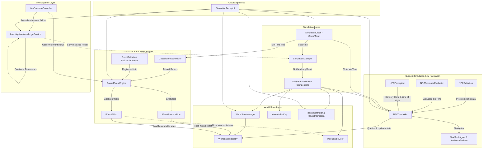

# Architecture Specification — Tomorrow's Crime

## 1. Architectural Philosophy

*Tomorrow's Crime* is built around the principle of a **deterministic causal simulation**.
Unlike conventional adventure games with branching dialog trees and linear flag triggers, this game models a small, coherent ecosystem where events occur naturally unless intervened upon by the player.

### Core Tenets
1. **Separation of Concerns:** Pure simulation and world-state rules are decoupled from Unity presentation (`MonoBehaviour` / rendering).
2. **Determinism:** Given the same initial conditions and zero player intervention, a loop produces the identical sequence of events every time.
3. **Explicit State Boundaries:** Mutable world state (doors, lights, NPC locations, keys) resets completely every 5 minutes. Persistent player knowledge (clues, observations, deduction notes) survives resets permanently.
4. **Testability:** Core logic is written in plain C# with minimal external dependencies, allowing comprehensive EditMode unit testing.

---

## 2. Core System Decomposition

---

## 3. Major Subsystems

### 3.1 Simulation Clock (`TomorrowsCrime.Simulation`)
- **Duration:** Exactly 300 seconds (5 minutes: 12:00 AM to 12:05 AM).
- **Time Scaling:** Debug multipliers (1x, 2x, 5x, 10x) for rapid playtesting.
- **Clock Model (`SimulationClockModel`):** Pure C# model containing elapsed time, loop count, time scale, pause state, and tick calculation.
- **Simulation Manager (`SimulationManager`):** MonoBehaviour bridge that updates the clock model every frame, triggers `OnTick`, and fires `OnLoopCompleted`.

### 3.2 Deterministic World State (`TomorrowsCrime.World`)
- **Registry (`WorldStateRegistry`):** Decoupled, pure C# typed dictionary tracking loop-scoped state under stable string keys (`key_room_102`, `door_room_102`).
  - Guards against duplicate ID registrations (`InvalidOperationException`).
  - Stores captured baseline states alongside mutable runtime states.
  - `ResetAllToBaseline()` restores every registered entity to its 12:00:00 condition.
- **Manager (`WorldStateManager`):** Scene-level MonoBehaviour singleton implementing `ILoopResetReceiver`. Dispatches reset signals to the registry.

### 3.3 First-Person Interaction System (`TomorrowsCrime.Player`)
- **Interface (`IInteractable`):** Defines `InteractionPrompt`, `CanInteract`, and `Interact(GameObject interactor)`.
- **Interaction Handler (`PlayerInteraction`):** Casts a 2.5m raycast forward from the player camera every frame. Detects `IInteractable` objects, debounces input (`KeyCode.E`), and feeds the contextual prompt to the HUD.

### 3.4 Causal Event Engine (`TomorrowsCrime.Events`)
- **Event Definition (`EventDefinition`):** Immutable-at-runtime `ScriptableObject` containing stable event ID, human-readable name, scheduled simulation time, priority, failure policy, prerequisites, preconditions (`IEventPrecondition`), and effects (`IEventEffect`).
- **Runtime Instance (`EventRuntimeInstance`):** Ephemeral execution state per loop (`Pending`, `Executing`, `Executed`, `Failed`, `Cancelled`, `Skipped`) with execution time and human-readable explanation.
- **Causal Engine Core (`CausalEventEngine`):**
  - **Deterministic Ordering:** Sorts eligible pending events by scheduled timestamp ascending, priority descending, and ID string ordinal.
  - **Graph Validation & Cycle Detection:** Depth-first search (DFS) with three-color recursion tracking prevents dependency cycles and validates all prerequisite references.
  - **Multi-Pass Resolution:** Fixed-point loop within each tick allows dependent events scheduled at or before the current time to resolve as soon as their prerequisites execute successfully.
  - **Prerequisite Failure Policies:** Configurable behavior when a prerequisite fails (`Skip`, `Fail`, `Cancel`).
  - **Effect Failure Safety:** Preconditions are evaluated completely before any effect modifies world state.
  - **Chronological History:** Evaluated events produce immutable `EventExecutionRecord` entries tracking simulation time, loop index, status, and reason.
  - **Loop Reset:** Resets all runtime instances to `Pending` and clears history when the 5-minute loop turns over.
- **Scheduler Bridge (`CausalEventScheduler`):** MonoBehaviour bridging `SimulationManager.OnTick` and `ILoopResetReceiver.OnLoopReset` to the pure C# engine.

### 3.5 Suspect Simulation & Navigation (`TomorrowsCrime.NPC`)
- **Character Definition (`NPCDefinition`):** `ScriptableObject` containing character ID, display name, baseline position, rotation, speed, stopping distance, perception parameters, and schedule activities.
- **Schedule Evaluator (`NPCScheduleEvaluator`):** Pure C# evaluator operating on half-open intervals `[StartTime, EndTime)`. Given simulation time, deterministically selects active activity (`WaitAtPost`, `RetrieveKey`, `UnlockDoor`, `Patrol`, `Idle`).
- **Runtime State (`NPCRuntimeState`):** Ephemeral state tracking high-level behavior (`Idle`, `Moving`, `PerformingAction`, `Investigating`, `Blocked`, `Waiting`), navigation status, missing key awareness, and decision explanations.
- **Locomotion & AI Navigation (`NPCController`):**
  - Uses Unity AI Navigation (`NavMeshSurface` & `NavMeshAgent`) for collision-free pathfinding across lobby floor.
  - Detects unreachable or invalid paths (**Reaction B: Blocked Route**) without infinite spam.
  - Reaches destinations and executes scheduled actions against live world state (**Reaction A: Missing Key** triggers `Investigating` state).
  - Implements `ILoopResetReceiver`: resets agent position/rotation, clears paths, and wipes transient awareness on loop reset.
- **Sensory Perception (`NPCPerception`):** Evaluates distance, horizontal FOV angle, and physics raycast line-of-sight to ensure NPCs cannot perceive actions behind their back or through occluding walls.

### 3.6 Persistent Knowledge Service (`TomorrowsCrime.Investigation`)
- **Service (`InvestigationKnowledgeService`):** Singleton knowledge store that survives loop resets.
- Deduplicates discoveries based on stable identifier (`key_missing_at_table`).
- Retains loop number and timestamp when discovery occurred.

### 3.7 Diagnostics & Observability (`TomorrowsCrime.Debugging`)
- Real-time HUD showing:
  - Loop index, elapsed & remaining time.
  - Keycard location (`At Table`, `Held by Player`, `Dropped Elsewhere`).
  - Door status (`Locked`, `Unlocked`).
  - Chronological Causal Event History with scrollable status badges and reasons.
  - Live NPC simulation diagnostics (Name, ID, behavior state, navigation status, active activity, and decision reason).
  - Persistent discoveries list.
  - Center reticle and contextual interaction prompt.
