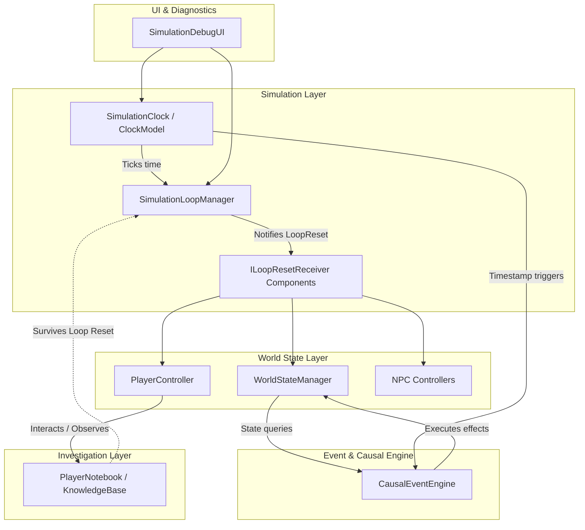

# Architecture Specification — Tomorrow's Crime

## 1. Architectural Philosophy

*Tomorrow's Crime* is built around the principle of a **deterministic causal simulation**.
Unlike conventional adventure games with branching dialog trees and linear flag triggers, this game models a small, coherent ecosystem where events occur naturally unless intervened upon by the player.

### Core Tenets
1. **Separation of Concerns:** Pure simulation rules are decoupled from Unity presentation (`MonoBehaviour` / rendering).
2. **Determinism:** Given the same initial conditions and zero player intervention, a loop produces the identical sequence of events every time.
3. **Explicit State Boundaries:** Mutable world state (doors, lights, NPC locations) resets completely every 5 minutes. Persistent player knowledge (clues, observations, deduction notes) survives resets permanently.
4. **Testability:** Core logic is written in plain C# with minimal external dependencies, allowing comprehensive EditMode unit testing.

---

## 2. Core System Decomposition

---

## 3. Major Subsystems

### 3.1 Simulation Clock (`TomorrowsCrime.Simulation`)
- **Duration:** Exactly 300 seconds (5 minutes: 12:00 AM to 12:05 AM).
- **Time Scaling:** Debug multipliers (1x, 2x, 5x, 10x) for rapid playtesting.
- **Clock Model (`SimulationClockModel`):** Pure C# model containing elapsed time, loop count, time scale, pause state, and tick calculation.
- **Simulation Manager (`SimulationManager`):** MonoBehaviour bridge that updates the clock model every frame, triggers `OnTick`, and fires `OnLoopCompleted`.

### 3.2 Loop Reset Subsystem (`TomorrowsCrime.Core`)
- **Interface:** `ILoopResetReceiver` defines `void OnLoopReset()`.
- **Reset Sequence:**
  1. `SimulationManager` detects clock reaches loop duration (or receives debug reset command).
  2. Broadcasts reset signal to all registered `ILoopResetReceiver` instances.
  3. Player position & rotation reset to initial lobby spawn point.
  4. World state properties (doors, items, electrical switches) restore to 12:00:00 initial values.
  5. Simulation clock resets elapsed time to `0.0f` and increments `LoopIndex`.

### 3.3 Player Locomotion (`TomorrowsCrime.Player`)
- First-person CharacterController-based controller.
- Supports both modern Input System actions and direct WASD/Mouse fallback.
- Implements `ILoopResetReceiver` to cache starting transform and restore state cleanly on loop turnover.

### 3.4 Developer Diagnostic Tools (`TomorrowsCrime.Debugging`)
- Real-time OnGUI overlay showing:
  - Active Loop Counter
  - Elapsed and Remaining Time formatted as `MM:SS`
  - Playback Controls (Pause / Resume / Speed Multipliers)
  - One-click Loop Reset button (`R` hotkey)
